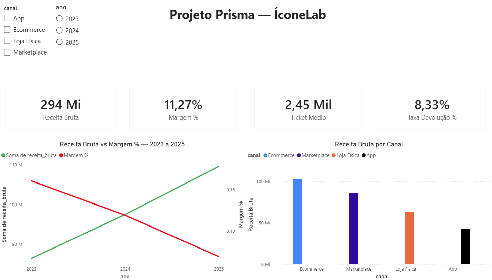
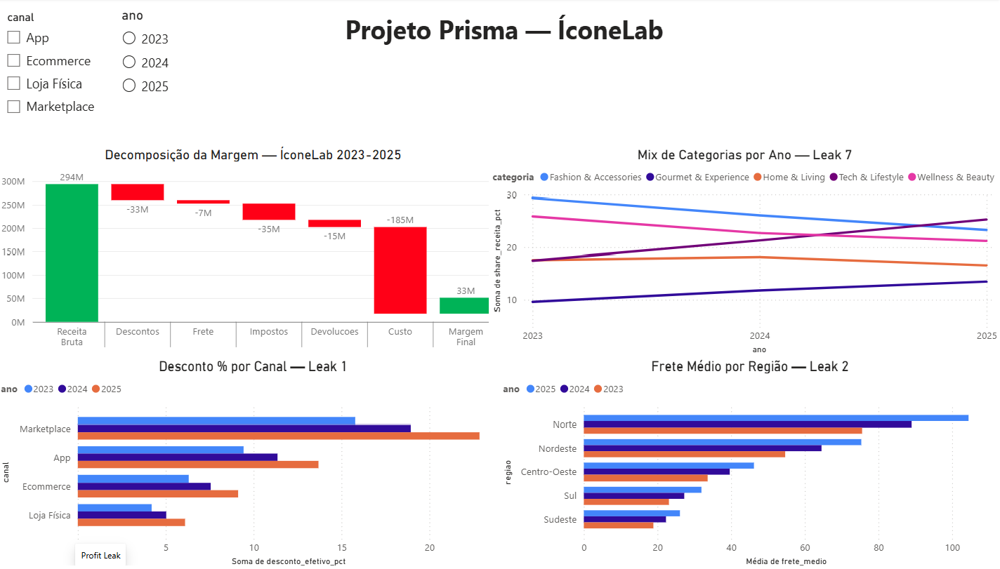
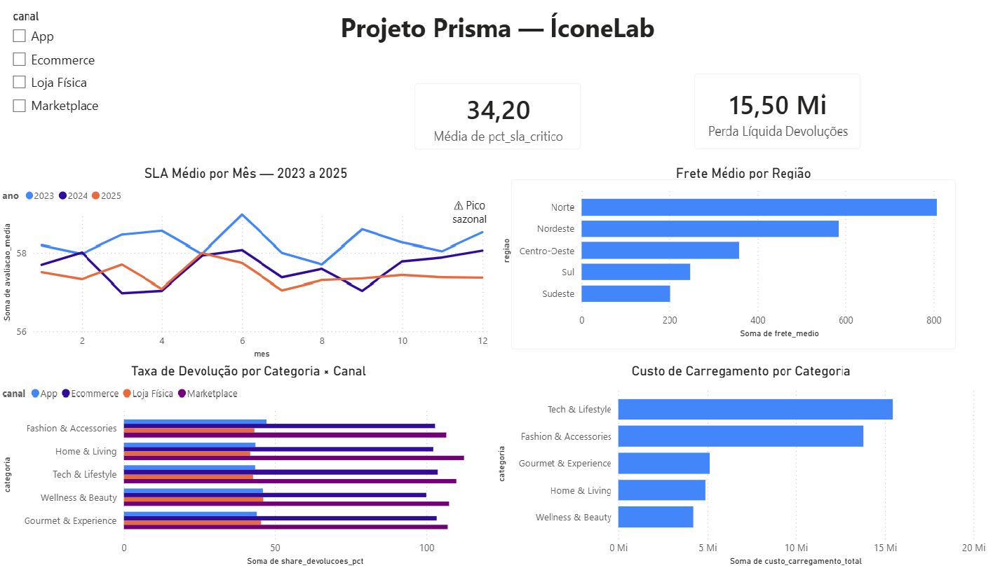
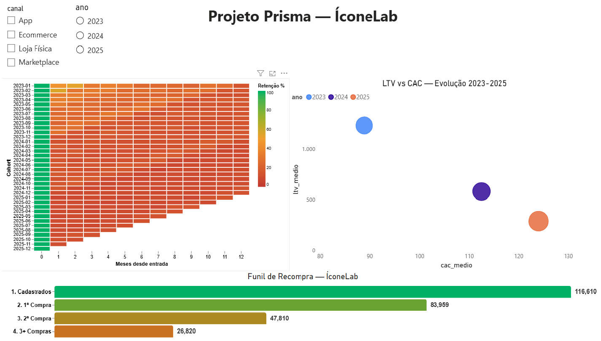
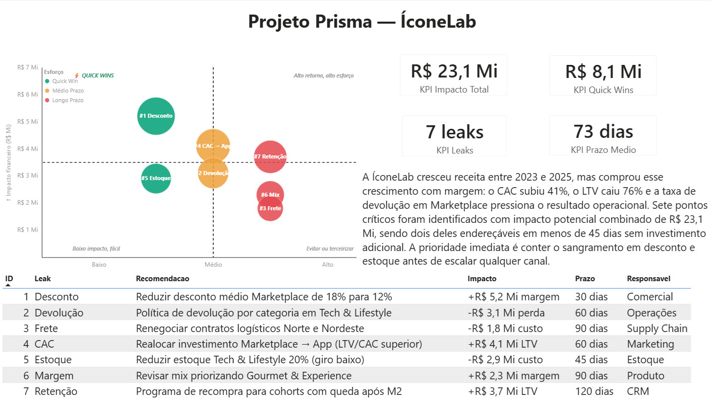

# 🔬 Prisma — Investigação de Erosão de Margem

> **Lufi Data Consulting** × **ÍconeLab**
> `Python` · `PostgreSQL` · `SQL` · `Power BI`

---

## O Problema

A ÍconeLab crescia.

Receita em expansão. Novos canais. Expansão regional. Por fora, tudo indicava uma operação saudável.
Por dentro, a margem encolhia silenciosamente — e o board não sabia onde estava o vazamento.

Em 2024, quando a margem caiu abaixo de 7%, o problema finalmente se tornou urgente.
A ÍconeLab contratou a **Lufi Data Consulting** para descobrir o que os relatórios não mostravam.

**O Prisma foi a investigação.**

---

## O Mandato

> *"Sabemos que estamos perdendo margem. Não sabemos onde. Precisamos saber antes que seja tarde demais."*
>
> **Board da ÍconeLab** — varejo premium omnichannel · 2024

A ÍconeLab é uma varejista premium multicanal com operação em Ecommerce, Marketplace, Lojas Físicas e App.
Entre 2021 e 2022, tomou duas decisões que pareciam razoáveis: acelerou a entrada no Marketplace e expandiu para Norte e Nordeste sem ajustar o modelo de frete.
Em 2023, quando os dados do projeto começam, essas decisões já estavam embutidas na operação — e é aí que o problema se torna visível nos números.

---

## A Pergunta Central

> **A ÍconeLab está crescendo de forma saudável — ou comprando receita com margem?**

---

## Os 7 Profit Leaks

Um Profit Leak (vazamento de lucro) é qualquer perda invisível ou gradual de dinheiro que ocorre dentro de uma empresa, fazendo com que a receita gerada não chegue ao resultado líquido final. De acordo com estudos de mercado, cerca de 90% das pequenas e médias empresas sofrem com esse problema, perdendo em média 9% do faturamento anual de forma silenciosa.

Neste projeto foram injetados de forma controlada e rastreável no dataset sintético. Cada leak tem um mecanismo documentado e uma query de diagnóstico dedicada.

| Leak | Nome | Mecanismo | Impacto encontrado |
|---|---|---|---|
| 1 | Desconto Marketplace | Multiplicador cresce 1.00 → 1.45 (2023→2025) | +R$ 5,2 Mi |
| 2 | Frete Norte/Nordeste | Base Norte R$72 vs Sudeste R$18 · crescimento +38% | -R$ 1,8 Mi |
| 3 | Devolução Tech | Taxa base 12% em Tech & Lifestyle · Marketplace amplifica ×1.35 | -R$ 3,1 Mi |
| 4 | CAC crescente | Eficiência de campanha cai enquanto investimento cresce | +R$ 4,1 Mi |
| 5 | Estoque parado | Reposição excessiva · capital imobilizado · giro baixo | -R$ 2,9 Mi |
| 6 | Mix baixa margem | Tech & Lifestyle cresce: 18% → 22% → 26% do mix | +R$ 2,3 Mi |
| 7 | Retenção | Cohort queda após M2 · abandono silencioso | +R$ 3,7 Mi |

**Impacto potencial total: R$ 23,1 Mi · Quick wins (≤ 45 dias): R$ 8,1 Mi**

---

## A Narrativa da ÍconeLab

```
2021–2022   Decisões aparentemente razoáveis
            Entrada acelerada no Marketplace
            Expansão para Norte e Nordeste sem ajustar frete

2023        O problema se torna visível nos números
            Receita cresce — margem encolhe
            Leaks já embutidos na operação

2024        O board percebe
            Margem cai abaixo de 7%
            Lufi Data Consulting é contratada

2024–2025   A investigação
            7 profit leaks identificados, quantificados e mapeados
            Plano de ação com R$ 23,1 Mi de impacto potencial
```

---

## As Frentes Analíticas

### 🏗️ Frente 0 — Dataset Sintético
> *Antes de qualquer análise, um dataset que simula uma operação real com problemas reais.*

120.000 pedidos · ~228.800 itens · 9 tabelas relacionais · Star Schema · 7 profit leaks injetados de forma controlada com SEED=42 para reprodutibilidade total.

**Tabelas:** `d_tempo` · `d_cliente` · `d_produto` · `d_canal` · `d_loja` · `f_vendas` · `f_marketing` · `f_estoque` · `f_devolucoes`

### 🔍 Frente 1 — SQL: Fundação
> *O banco de dados que sustenta a investigação.*

PostgreSQL com schema tipado, constraints de integridade e views analíticas base. Estrutura que permite que qualquer query de diagnóstico seja escrita sem preparação adicional.

### 📊 Frente 2 — SQL: Análise de Negócio
> *7 queries de diagnóstico — uma por profit leak.*

Cada query isola um leak, quantifica o impacto financeiro e produz o insumo para o dashboard. Análise de cohort de retenção, Pareto de canal × região e decomposição de margem por dimensão.

### 📈 Frente 3 — Power BI: Dashboard Executivo
> *Onde o diagnóstico vira decisão.*

5 páginas integradas em narrativa visual coerente. Visualizações avançadas via Deneb/Vega-Lite — heatmap de cohort, bubble chart impacto × esforço e funil de recompra.

| Página | Foco | Destaques |
|---|---|---|
| 1 — Executive Summary | Visão geral · KPIs · saúde da operação | Receita vs Margem 2023–2025 — as linhas que se cruzam |
| 2 — Profit Leak | Waterfall de margem · drill-through por canal | Decomposição: Receita 294M → Margem Final 33M |
| 3 — Clientes | Cohort de retenção · LTV vs CAC · segmentação | CAC +41% · LTV -76% em 2 anos |
| 4 — Operação | Frete · SLA · devoluções · estoque | 34,2% dos pedidos em SLA crítico |
| 5 — Plano de Ação | 7 recomendações com impacto financeiro estimado | R$ 23,1 Mi · Quick wins em 45 dias |

[](https://github.com/DataLufi/prisma/blob/main/assets/p1_executive_summary.png)
[](https://github.com/DataLufi/prisma/blob/main/assets/p2_profit_leak.png)
[](https://github.com/DataLufi/prisma/tree/main/assets#:~:text=26%20minutes%20ago-,p4_opera%C3%A7%C3%A3o.png,-upload%20imagens)




### 🗣️ Frente 4 — Reputação & Voz do Mercado *(melhoria futura)*
> *O que os clientes dizem publicamente — e o que isso revela além do financeiro.*

Escopo planejado: reviews sintéticos + benchmark setorial. NLP com BERTimbau para categorização automática de motivos. Cruzamento de sentimento público com queda de margem.

Não implementado nesta versão. Identificado como extensão natural do diagnóstico financeiro — os dois sinais (financeiro e reputacional) chegam juntos em operações sob pressão.

---

## Resultado do Diagnóstico

A ÍconeLab cresceu receita entre 2023 e 2025, mas comprou esse crescimento com margem: o CAC subiu 41%, o LTV caiu 76% e a taxa de devolução no Marketplace pressiona o resultado operacional.

Sete pontos críticos foram identificados — com impacto potencial combinado de **R$ 23,1 Mi** — sendo dois deles endereçáveis em menos de 45 dias sem investimento adicional.

**A prioridade imediata é conter o sangramento em desconto e estoque antes de escalar qualquer canal.**

---

## Arquitetura

```
[GERAÇÃO DO DATASET]
Python (NumPy vetorizado, SEED=42)
01_Concepção_e_Arquitetura.ipynb
9 CSVs · ~228.800 linhas · 7 profit leaks controlados

        ↓

[BANCO DE DADOS]
PostgreSQL
00_schema.sql → ingestão via COPY → views analíticas

        ↓

[ANÁLISE SQL]
01_views.sql → 02_queries_negocio.sql
7 diagnósticos · impacto financeiro por leak

        ↓

[DASHBOARD]
Power BI Desktop — prisma_dashboard.pbix
Modelo estrela · DAX · Deneb/Vega-Lite · 5 páginas
```

---

## Stack


---

## Status do Projeto

| Milestone | Status |
|---|---|
| M0 — Concepção e Arquitetura | ✅ Concluído |
| M1 — SQL: Fundação | ✅ Concluído |
| M2 — SQL: Análise de Negócio | ✅ Concluído |
| M3 — Power BI: Modelo + Pág. 1-2 | ✅ Concluído |
| M4 — Power BI: Pág. 3-5 + Entrega | ✅ Concluído |
| M5 — Reputação & Voz do Mercado | 🔜 Melhoria futura |

---

## Como Reproduzir o Dataset

O dataset é sintético — gerado em Python com regras de negócio reais e profit leaks controlados.
Reprodutível com `SEED=42`. Não requer download externo.

```bash
pip install -r requirements.txt

# Execute o notebook completo:
jupyter notebook "01___Concepção_e_Arquitetura.ipynb"
```

> ⏱️ Tempo estimado de geração: ~3 minutos

---

## Sobre

Projeto desenvolvido pela **Lufi Data Consulting** como parte do portfólio de transição de carreira para dados.

Engenheiro de Produção com 10 anos de experiência em operações, processos e análise administrativa — agora usando dados como ferramenta de decisão de negócio.

[](https://www.linkedin.com/in/filholuiz)
[](https://github.com/DataLufi)

---

*Dataset sintético gerado para fins analíticos. ÍconeLab é uma empresa fictícia criada para contextualizar a análise.*
*Período simulado: 2023–2025.*
